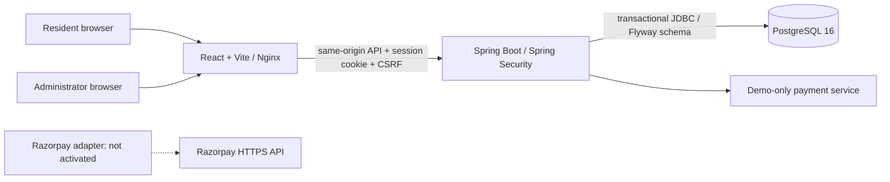
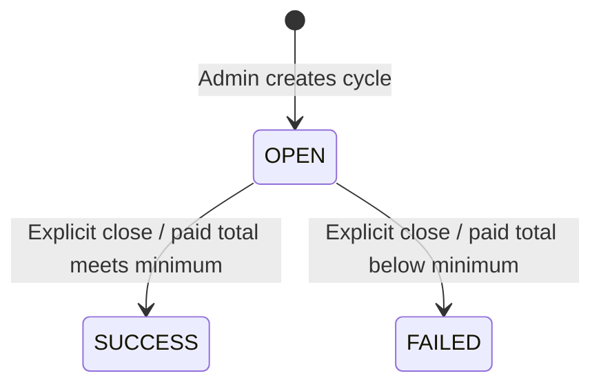
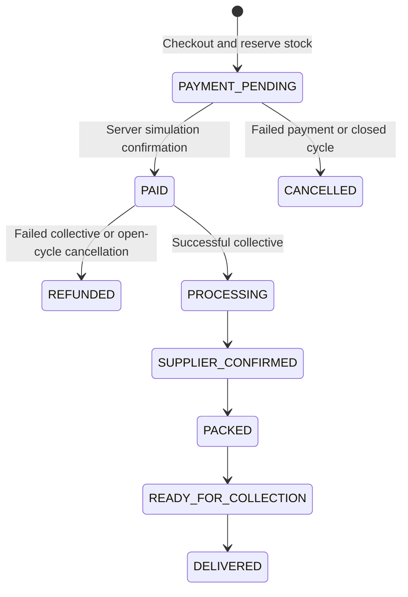
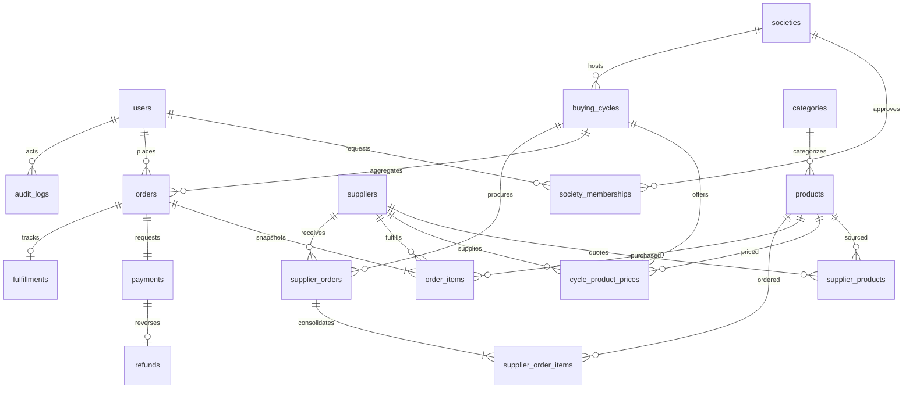

# Architecture

The backend is one application, not microservices. Account lookup uses a Spring Data JPA entity/repository; commerce operations use parameterized `JdbcTemplate` SQL so locking and procurement aggregation remain explicit. `Api` currently groups the vertical workflows and should be split into feature controllers/services before substantial expansion. DTO records and Bean Validation validate requests; `Errors` returns safe client messages.

Money is stored in bigint paise. Checkout ignores frontend totals and snapshots reference, group, and supplier cost per item. Stock is reserved transactionally. Checkout, payment, closure, and cancellation all lock the cycle first, serializing stock and cycle transitions. A per-user unique order key prevents duplicate orders on retry; reuse with different cycle, method, or item quantities returns 409. Payments are unique per order. Repeating a finalized simulated payment returns the existing result. Closing a finalized cycle returns its existing state without duplicate supplier orders/refunds.

## State machines

Order payment state and fulfillment state are separate. Delivery orders use `OUT_FOR_DELIVERY` before `DELIVERED`; collection orders use `READY_FOR_COLLECTION`. Failed cycles simulate refunds; no bank transfers occur.

## Entity relationships

UUID keys, referential constraints, unique keys, nonnegative price/stock checks, and query indexes are created by Flyway. Flyway owns DDL; Hibernate never modifies it. A second migration adds consistent creation/update timestamps and update triggers across all 17 application tables.
